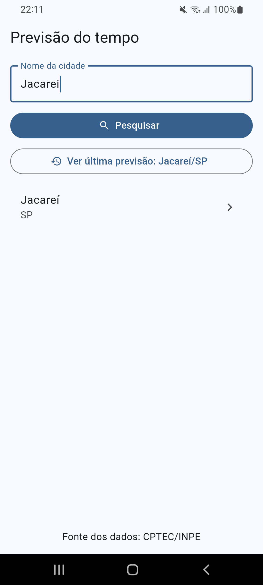
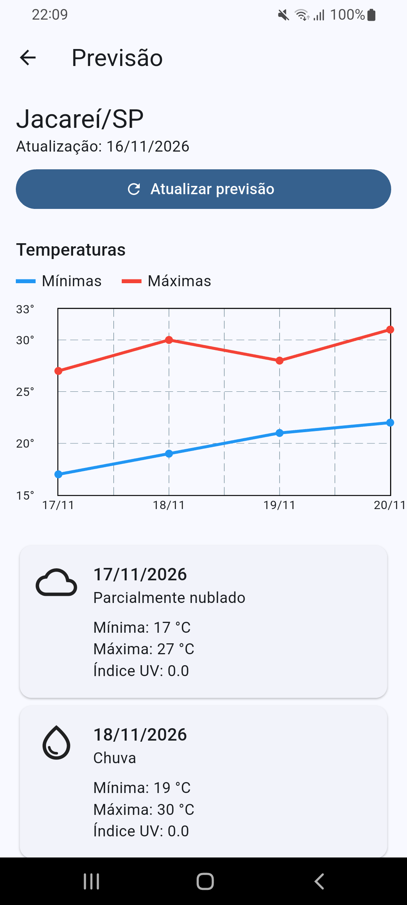
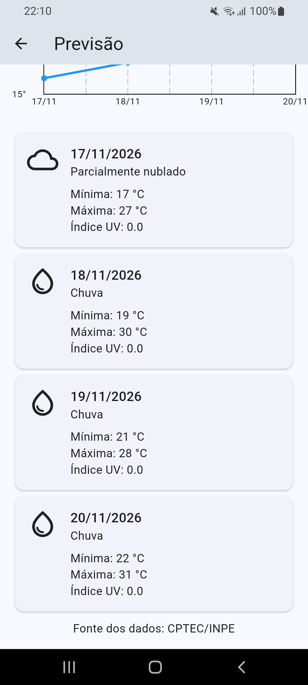
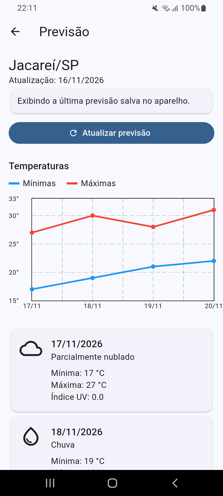

# Atividade 2 - Previsão do tempo

Atividade da disciplina de Programação para Dispositivos Móveis I.

**Aluno:** Eric França Arantes dos Santos

**Professor:** Arley

## Funcionalidades

- Pesquisa de cidades brasileiras pelo nome.
- Exibição do nome e da UF das localidades encontradas.
- Consulta da previsão do tempo para quatro dias.
- Exibição de data, temperaturas mínima e máxima, condição do tempo, ícone e índice UV.
- Gráfico com as temperaturas mínimas e máximas.
- Atualização da previsão da cidade selecionada.
- Identificação do CPTEC/INPE como fonte dos dados.
- Indicadores de carregamento e mensagens para os diferentes erros.
- Armazenamento da última previsão válida no aparelho.

## Bibliotecas utilizadas

- `http`: realização das requisições HTTPS.
- `xml`: interpretação das respostas XML do CPTEC/INPE.
- `fl_chart`: gráfico de temperaturas mínimas e máximas.
- `shared_preferences`: persistência local da última previsão válida.

## Persistência local

A última previsão válida é convertida para JSON e salva com
`shared_preferences`. São armazenados a cidade, a UF, o identificador da
localidade, a data de atualização e todos os dias da previsão.

Ao abrir novamente o aplicativo, o botão **Ver última previsão** permite
recuperar os dados salvos. Se uma atualização falhar, a previsão anterior não
é apagada.

## Como executar

Com Flutter e Android SDK instalados, conecte um dispositivo Android e execute:

```bash
flutter pub get
flutter run
```

## Serviço utilizado

Os dados são consultados no serviço oficial em XML do CPTEC/INPE:

<https://servicos.cptec.inpe.br/XML/>

## Verificação

O aplicativo foi analisado, compilado e testado em um Samsung Galaxy A31 com
Android 12. Foram conferidos a pesquisa de cidades, os quatro dias da previsão,
o gráfico, a atualização, a mensagem de pesquisa sem resultados e a recuperação
da última previsão após fechar e reabrir o aplicativo.

## Capturas de tela

### Pesquisa de cidades



### Previsão e gráfico de temperaturas



### Quatro dias retornados pelo serviço



### Recuperação da previsão salva


